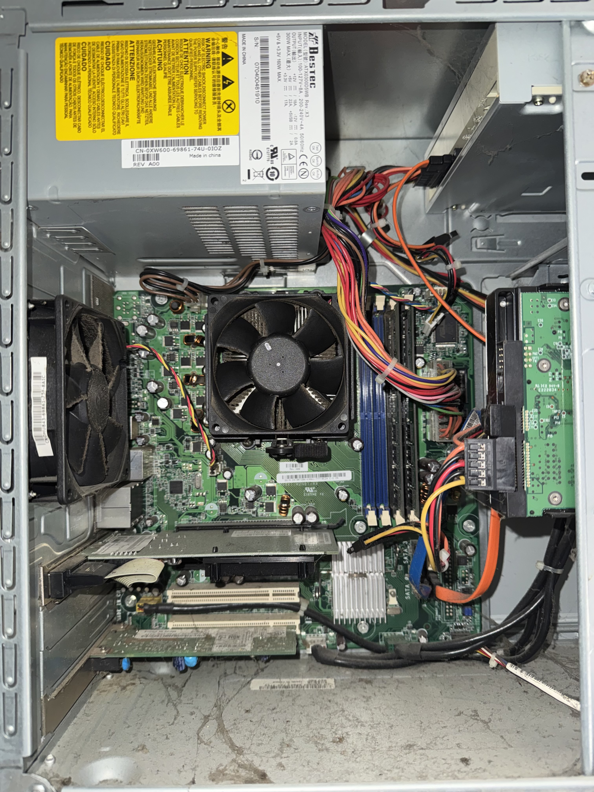
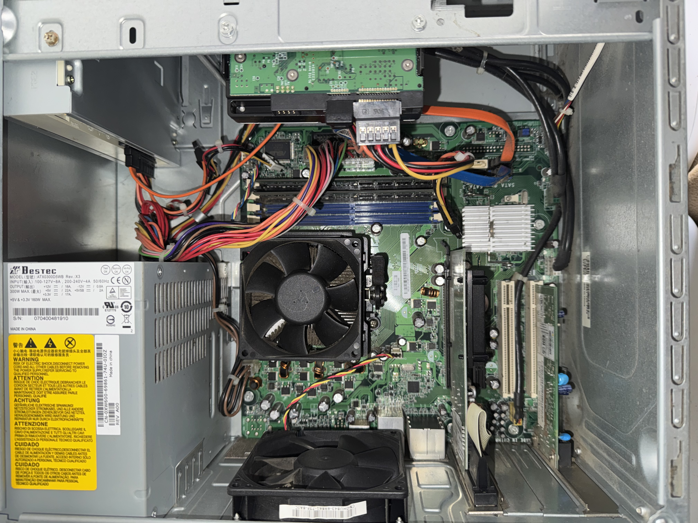

 xz x# Hardware Maintenance Log

## Initial Maintenance — Completed (Nov. 23, 2026)

### Objectives

Inspect and clean the Dell Inspiron 531 before installing Linux.

### Planned Procedure

- [x] Shut down the computer.
- [X] Disconnect the power cable and peripherals.
- [X] Open the side panel.
- [X] Photograph the internal hardware before cleaning.
- [X] Count the installed RAM sticks.
- [X] Identify RAM capacities and available slots.
- [X] Inspect the motherboard and internal connections.
- [X] Inspect fans, heatsinks, and ventilation areas.
- [X] Remove dust using appropriate cleaning tools.
- [X] Reassemble the computer.
- [X] Power on and verify successful startup.

### Safety Precautions

- Disconnect power before opening the computer.
- Avoid touching exposed electrical contacts.
- Hold fan blades stationary when using compressed air.
- Do not open the power supply.
- Avoid using a household vacuum directly on internal components.

### Results

- Successfully opened and inspected the Dell Inspiron 531.
- Confirmed four RAM slots: two occupied and two available.
- Removed dust from the case floor, CPU fan, and accessible interior surfaces.
- Inspected internal cables and connectors.
- Reassembled the computer and successfully powered it on.
- Operating system boot verification: Pending confirmation.

### Observations

- The computer contains 2 GB of DDR2 RAM across two installed modules.
- Individual RAM module capacities have not yet been verified.
- Dust had accumulated around the CPU cooling fan, motherboard, and case floor.
- Several unused connectors were identified; no changes were made to their connections.
- No obvious physical damage was observed during the inspection.
- The interior appeared noticeably cleaner after maintenance.

### Photos

- 
- 

### Issues Encountered

- No hardware problems observed during cleaning.
- Unused internal connectors were inspected and left disconnected.