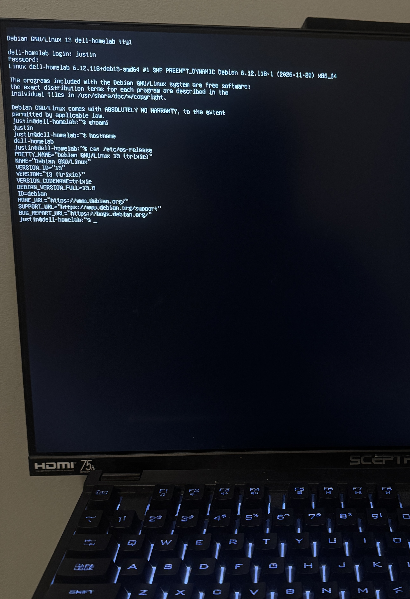

# Linux Installation

## Objective

Replace Windows 7 with a lightweight Linux operating system to establish a dedicated home lab environment.

## Operating System Selection

- Distribution: Debian 13.8.0 (Trixie)
- Architecture: AMD64 (64-bit)
- Installation image: Network installer (netinst)
- Reason for selection: Low resource requirements, stability, and suitability for server administration.

## Bootable USB Creation

### Tools Used

- Windows 11 computer
- USB flash drive
- Rufus 4.16
- debian-13.8.0-amd64-netinst.iso

### Rufus Configuration

| Setting | Value |
|---|---|
| Partition Scheme | MBR |
| Target System | BIOS or UEFI |
| File System | FAT32 |
| Cluster Size | 16 KB |
| Persistence | None |
| Write Mode | ISO Image Mode |

MBR was selected for compatibility with the Dell Inspiron 531's legacy BIOS.

### Procedure

1. Downloaded the Debian ISO from the official Debian website.
2. Downloaded and launched Rufus.
3. Connected the USB flash drive.
4. Selected the Debian ISO and configured the boot settings.
5. Downloaded the required Syslinux bootloader files.
6. Created the bootable installation media.

## Debian Installation

### Installation Configuration

| Configuration | Value |
|---|---|
| Operating System | Debian 13 |
| Architecture | AMD64 (64-bit) |
| Installation Method | Bootable USB |
| Hostname | dell-homelab |
| Firmware | Legacy BIOS |
| Partition Table | MBR |
| Filesystem | ext4 |
| Swap | Enabled |
| Package Mirror | deb.debian.org |
| Bootloader | GRUB |
| Desktop Environment | None |

### Installation Procedure

1. Connected the Ethernet cable and bootable USB.
2. Booted into the Debian installer using USB-HDD0.
3. Configured the hostname and user account.
4. Configured disk partitioning using ext4 and swap.
5. Replaced the existing Windows 7 installation.
6. Configured the Debian package manager.
7. Selected SSH server and standard system utilities.
8. Installed the GRUB bootloader.
9. Rebooted into Debian.
10. Successfully logged into the system.

### Design Decisions

A minimal Debian installation without a graphical desktop environment was chosen to reduce resource consumption due to the system's limited 2 GB of RAM.

SSH was selected to allow remote server administration from another computer.

### Results

Debian successfully booted from the internal hard drive, and the user was able to log into the command-line interface.

### Next Steps

- [ ] Verify system information.
- [ ] Verify hardware recognition.
- [ ] Test network connectivity.
- [ ] Update system packages.
- [ ] Verify SSH service and remote access.